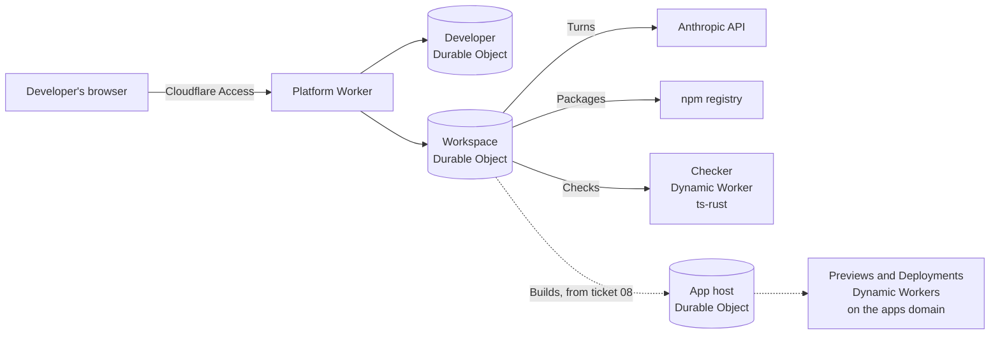

# Jigworks

A browser-based platform where a Developer and an AI Agent build Cloudflare Workers apps together, from the first file to a hosted app. Every step runs in Workers isolates: editing, type-checking, building, running and hosting. There are no containers, virtual machines or local tools.

An organisation installs Jigworks on its own Cloudflare account, behind its own sign-in. Its people then build internal tools by talking to the Agent, on infrastructure the organisation already runs.

## Status

Jigworks began as an experiment: can Workers isolates alone be where an application is developed? It's built in stages, and each stage ends with a verdict and its measurements in [`docs/findings.md`](docs/findings.md).

| Stage | What | Verdict |
| --- | --- | --- |
| 1 | ts-rust Checks and esbuild Builds inside a Durable Object | yes, with a caveat about memory |
| 2 | Workspaces, the editor, live Checks | yes: a Check takes about 0.2 s |
| 3 | The Agent, with a Check at the end of every Turn | yes: Turns of 6–40 s, about $0.03–0.11 each |
| 4 | Builds, and the Preview | Builds fit, at about 0.2 s; the Preview is next |
| 5–6 | Deployments, app data and secrets; tests in isolates | to come |

The open work is in the [issues](https://github.com/moverperfect/jigworks/issues), and the spec is [#23](https://github.com/moverperfect/jigworks/issues/23).

## How it works



- **A Workspace** is one Durable Object holding its files, its Packages and its one Conversation with the Agent, which runs on Cloudflare's Think framework ([ADR 0003](docs/adr/0003-one-durable-object-per-workspace.md)).
- **Checks** run [ts-rust](https://github.com/pingdotgg/ts-rust), a TypeScript checker written in Rust, compiled to WebAssembly and run in a Dynamic Worker of its own ([ADR 0002](docs/adr/0002-ts-rust-is-the-checker.md), [ADR 0010](docs/adr/0010-checks-run-in-a-dynamic-worker.md)).
- **Builds** run esbuild inside the Workspace, through `@cloudflare/worker-bundler`.
- **Each Turn** ends with a Check and a Build. While either has errors, the Agent gets up to three more tries ([ADR 0011](docs/adr/0011-the-platform-runs-each-turn.md)).
- **Durable Objects are the only storage** ([ADR 0004](docs/adr/0004-durable-objects-are-the-only-storage.md)). Apps will run on Dynamic Workers inside the platform, on a domain of their own ([ADR 0006](docs/adr/0006-deployments-run-on-dynamic-workers.md), [ADR 0012](docs/adr/0012-apps-live-on-a-domain-of-their-own.md)).

The words used throughout, such as Workspace, Turn, Check and Installation, are defined in [`GLOSSARY.md`](GLOSSARY.md). The decisions that are hard to reverse are in [`docs/adr/`](docs/adr/), and the research behind them is in [`docs/research/`](docs/research/).

## Running an Installation

An Installation needs:
- a Cloudflare account on Workers Paid;
- two domains: one for the platform, and one for apps;
- Cloudflare Zero Trust, whose Free plan covers up to 50 people;
- an Anthropic API key for the Agent.

`scripts/set-up-installation.sh` walks the Operator through setting these up. For now it's written for the first Installation; [#21](https://github.com/moverperfect/jigworks/issues/21) turns it into an install path for any organisation.

## Developing Jigworks

```sh
pnpm install
pnpm generate
pnpm test
pnpm platform:dev
```

[`docs/development.md`](docs/development.md) covers running it locally, deploys, live checks and the lessons learned along the way. Every merge to `main` deploys.

## Licence

Jigworks is source-available, not open source.
- **Free:** personal use, research, charities, schools, public research bodies and government ([PolyForm Noncommercial 1.0.0](LICENSE.md)).
- **Evaluation:** a company may evaluate it for less than 32 consecutive days (PolyForm Free Trial 1.0.0).
- **Companies:** using it beyond that needs a commercial licence. Email licensing@jigworks.dev.

Third-party code keeps its own licences; see [`NOTICE.md`](NOTICE.md).

## Contributing

Issues are welcome. Pull requests from outside aren't accepted yet, because a contributor licence agreement must come first.
